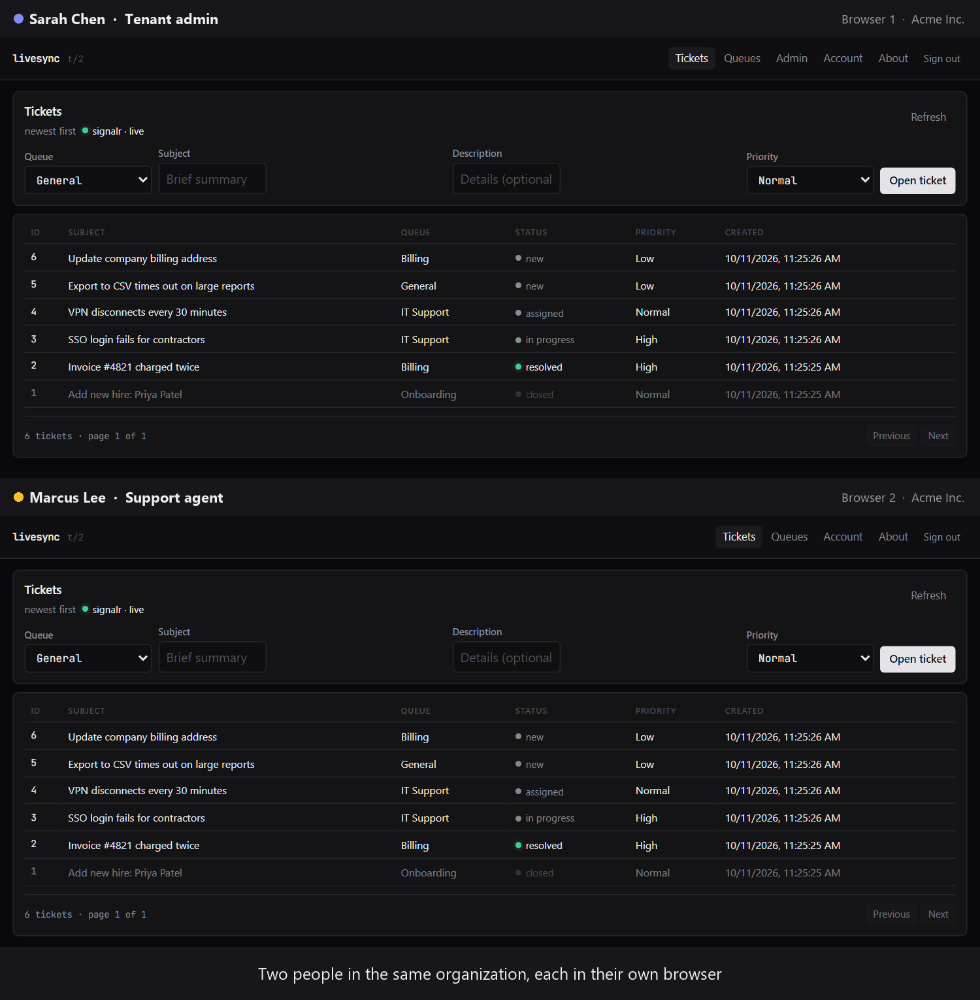
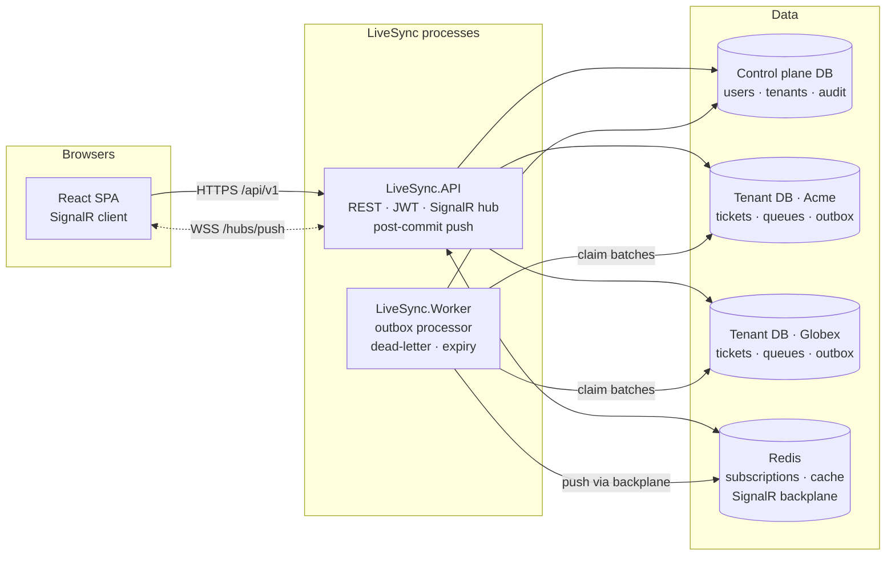
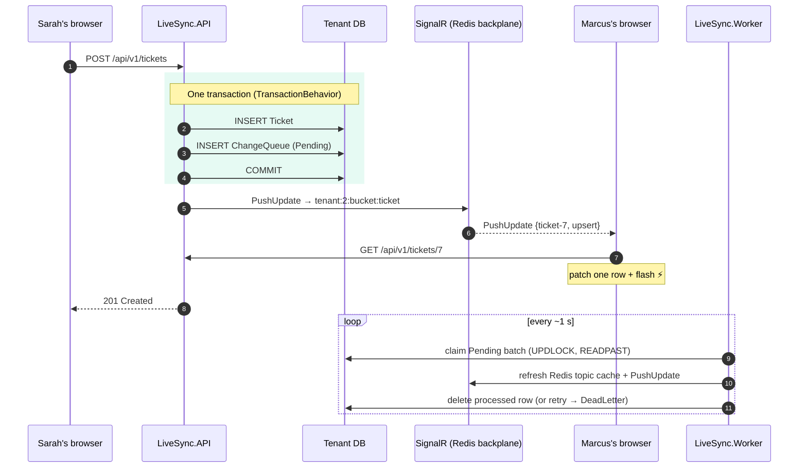
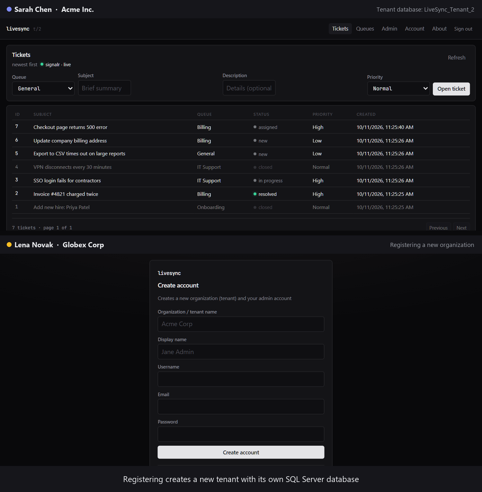
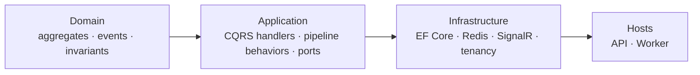
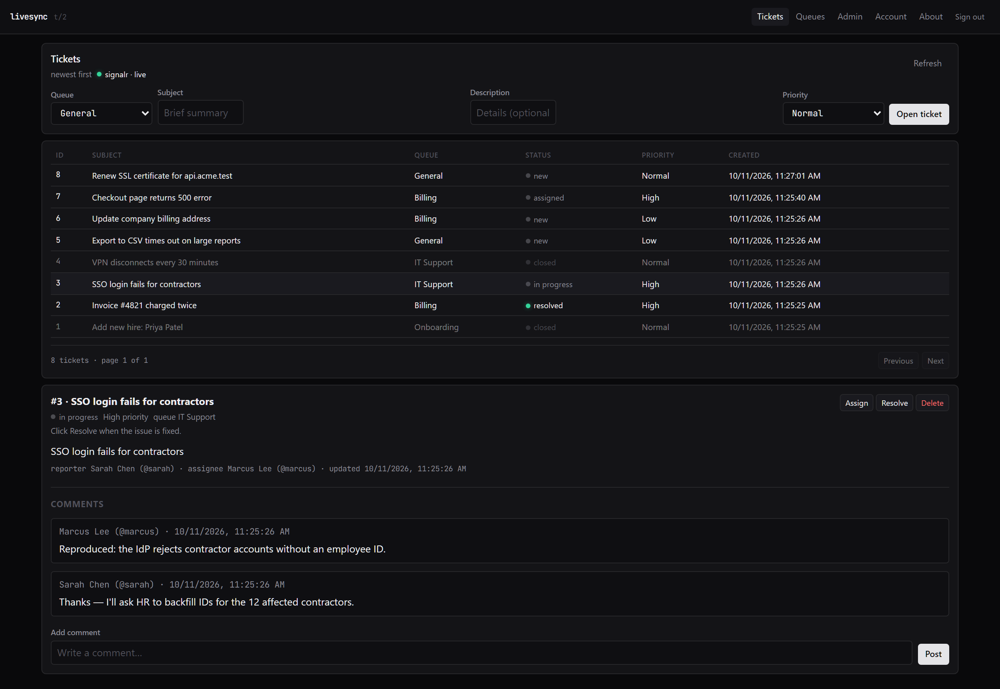
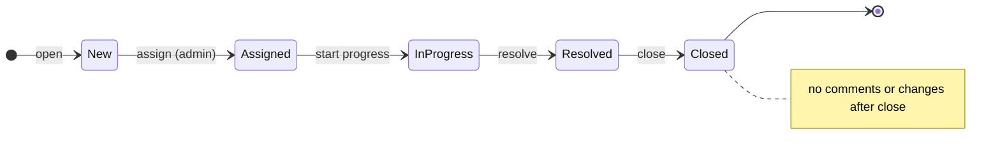
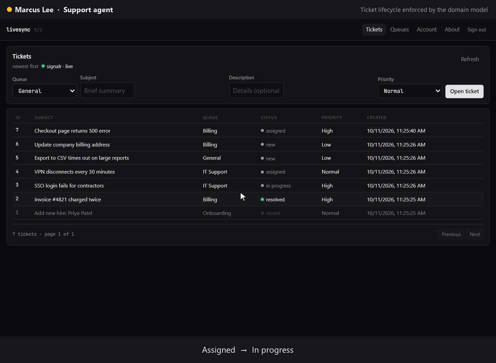
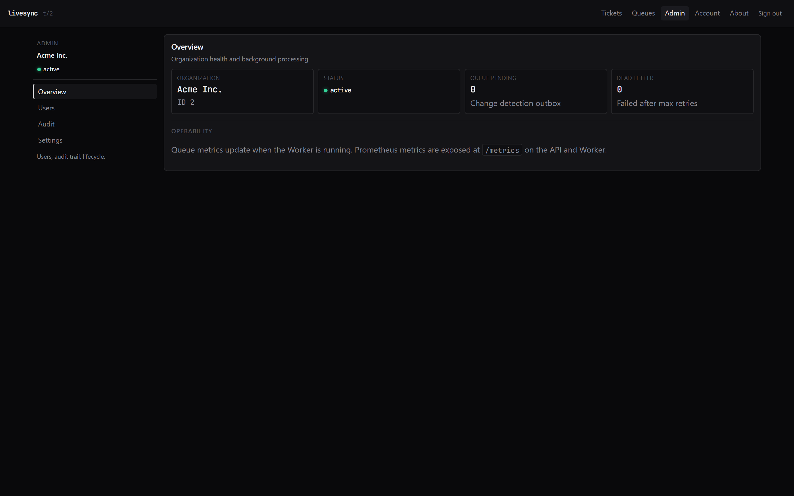
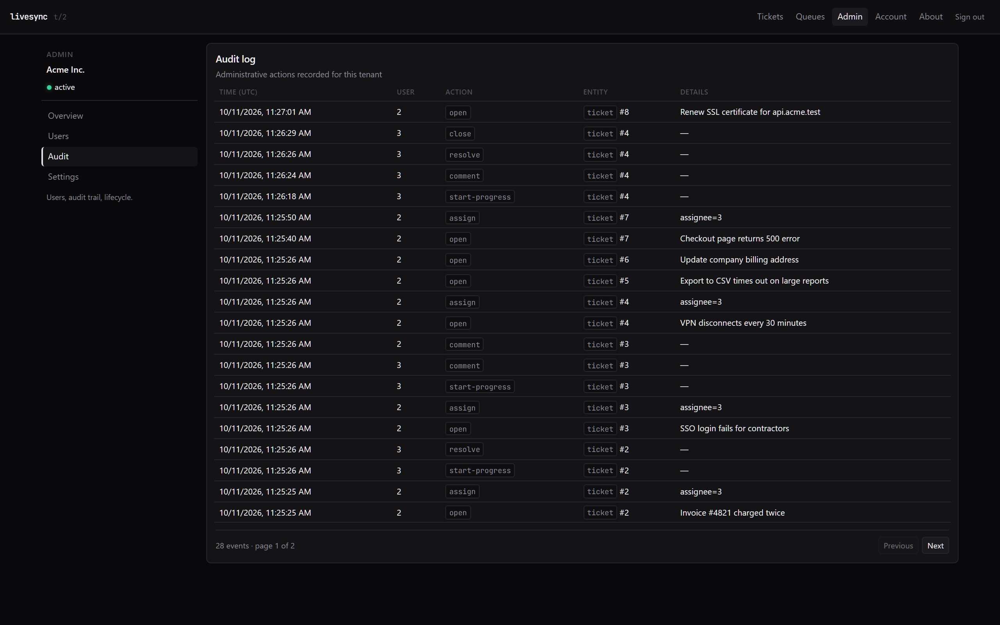

<div align="center">

# LiveSync

**A multi-tenant support desk where every agent sees every change the moment it happens, and no customer ever sees another customer's data.**

A portfolio-grade reference architecture for B2B SaaS: database-per-tenant isolation, DDD + CQRS, a transactional outbox, and bucket-scoped real-time push over SignalR.

[](https://github.com/ismayilov449/LiveSync/actions/workflows/ci.yml)




<sub>Recorded from the running app: two isolated browser sessions in the same tenant, driven by Playwright.</sub>

[The problem](#-the-problem) · [The approach](#-the-approach) · [How it works](#-how-it-works) · [Features](#-features) · [Quick start](#-quick-start) · [For reviewers](#-for-reviewers--interviewers)

</div>

---

## At a glance

| | |
|---|---|
| **What it is** | A support desk SaaS (queues, tickets, comments, admin console) used as a vehicle for production-grade multi-tenant and real-time patterns. |
| **Problem it solves** | Agents working the same queue see stale data and step on each other, and a B2B product must guarantee one customer's data never reaches another's screen. |
| **Isolation** | One SQL Server database **per tenant**, plus a control-plane database for users, tenants and audit. |
| **Live sync** | Domain events → **transactional outbox** → immediate post-commit push + Worker consistency push → **bucket-scoped SignalR groups** → client patches one row in place. |
| **Platform features** | RBAC, per-tenant rate limiting, idempotency keys, audit log, tenant suspend/reactivate, Prometheus metrics, OpenTelemetry, health probes. |
| **Proof** | 35 automated tests, including integration tests against real SQL Server + Redis containers that verify tenant isolation, push delivery and outbox atomicity. |

> **30-second pitch:** Registering creates a new organization with its own SQL database. Agents share queues and tickets that follow a strict lifecycle enforced by the domain model. Every change is written to an outbox **in the same transaction** as the business data. Right after commit, the API pushes it over SignalR to everyone viewing that kind of data in that tenant, and a background Worker delivers it again from the outbox, so nothing is lost if the instant push fails. Browsers patch the affected row in place.

---

## 🧩 The problem

Picture a support team of twelve agents working the same **Billing** queue.

1. **Stale screens cause real damage.** Agent A assigns a ticket to herself; agent B, looking at a five-minute-old list, picks the same ticket. Two people work one issue while another waits. Status changes, comments and new tickets need to reach everyone **as they happen**.
2. **Multi-tenancy raises the stakes.** This is B2B SaaS: Acme's tickets must never appear for Globex. In a shared-table design, one missing `WHERE TenantId = @id` is a data breach.
3. **Real-time is a distributed-systems problem in disguise.** Saving to the database and notifying browsers are two separate systems. Do them naively and you get the *dual-write* problem: the push gets lost when the process dies after commit, or clients get notified about a change that was rolled back.
4. **It has to be operable.** When live updates feel slow, an operator needs to see whether the backlog is growing or messages are failing.

### Why the obvious approaches fail

| Naive approach | What goes wrong | What LiveSync does instead |
|---|---|---|
| Poll the API every few seconds | Latency equals the poll interval; load grows with users × open tabs | **Server push** over SignalR WebSockets |
| Broadcast every change to the whole tenant | Every page reacts to every change; the Queues page refetches when a ticket gets a comment | **Bucket-scoped groups**: `tenant:{id}:bucket:{ticket\|queue}` |
| Store connection IDs and push to them | Reconnects and background tabs leave stale IDs, so users silently miss updates | Connections **join groups** on every (re)subscribe; delivery never depends on stored IDs |
| Publish to SignalR right after `SaveChanges` | Lost notifications on crash; phantom notifications on rollback | **Transactional outbox** plus a push sent only **after commit** |
| Shared tables with a `TenantId` column | One forgotten filter leaks data across customers | **Database per tenant**, with EF global query filters and save-time tenant validation as defense in depth |
| Refetch the whole list on every push | Network and render churn; scroll position and selection reset | **Row-level patch**: fetch one entity, update one row, flag remote changes |

---

## 💡 The approach

### 1. Database-per-tenant, with a control plane

Each organization gets its own database (`LiveSync_Tenant_{id}`), created and migrated automatically on registration. A separate **control plane** database stores identity, the tenant registry and the audit log. The JWT carries a `tenant_id` claim, middleware checks that the user belongs to that tenant, and the request's `DbContext` connects to that tenant's database only. Inside each database, EF Core global query filters and a save-time ownership check add a second layer of protection.

**Trade-off:** more databases to migrate and more connection pools to manage, in exchange for hard isolation and per-customer backup and restore. → [ADR 001](LiveSync.PushPlatform/docs/adr/001-database-per-tenant.md)

### 2. Transactional outbox: no lost and no phantom notifications

Ticket and queue commands carry a marker interface, `ITransactionalCommand`. A MediatR `TransactionBehavior` runs each such command inside a single database transaction, managed by EF Core's retrying execution strategy:

```
BEGIN TRANSACTION
  handler saves the Ticket aggregate          (identity id generated)
  domain event → Enqueue*Handler writes ChangeQueue row (Pending)
COMMIT                                         ← both rows or neither
→ buffered SignalR push sent (best-effort)
```

If writing the outbox row fails, the ticket is rolled back as well. An integration test proves this by injecting a failing outbox store. The immediate push waits in `PostCommitNotifications` until the commit succeeds, and a failed push only logs a warning, because the outbox row guarantees the Worker will deliver the change. → [ADR 003](LiveSync.PushPlatform/docs/adr/003-change-queue-outbox.md)

### 3. Two delivery paths, on purpose

| Path | Latency | Guarantee | Role |
|---|---|---|---|
| **API, post-commit push** | milliseconds | best-effort | Makes the UI feel instant |
| **Worker, outbox processing** | ~1 s poll | at-least-once, retries, then **dead-letter** | Reliability, Redis cache consistency, filtered subscriptions |

The Worker claims batches with `UPDLOCK, READPAST` row locks and a per-tenant Redis distributed lock, so several Worker replicas can run safely. After `MaxRetries` (default 5) a change moves to **DeadLetter**, which the admin console and Prometheus both show. → [ADR 002](LiveSync.PushPlatform/docs/adr/002-api-worker-split.md)

### 4. Bucket-scoped SignalR groups

On `FindAndSubscribe`, a connection joins `tenant:{tenantId}:bucket:{ticket|queue}`. The Tickets page never wakes up for Queue changes, and a different tenant's group is unreachable by construction. A Redis backplane lets the Worker reach browsers connected to any API instance. → [ADR 004](LiveSync.PushPlatform/docs/adr/004-signalr-tenant-groups.md), [ADR 005](LiveSync.PushPlatform/docs/adr/005-multi-bucket-real-time-sync.md)

### 5. Rich domain model, not CRUD

`Ticket` is an aggregate root that owns its `TicketComment` entities and enforces its lifecycle. Invalid transitions throw from the domain and surface as RFC 7807 errors. `Queue` is a separate aggregate that cannot be deactivated while it still has open tickets. → [ADR 006](LiveSync.PushPlatform/docs/adr/006-support-desk-aggregates.md)

---

## 🔍 How it works

### System architecture



### Life of a change: opening a ticket



### Tenant isolation, layer by layer

```
LiveSync_ControlPlane        LiveSync_Tenant_2 (Acme)      LiveSync_Tenant_3 (Globex)
├── Tenants                  ├── Queues                    ├── Queues
├── AspNetUsers (TenantId)   ├── Tickets                   ├── Tickets
├── AspNetRoles              ├── TicketComments            ├── TicketComments
└── AuditEvents              ├── ChangeQueue   ← outbox    ├── ChangeQueue
                             └── IdempotencyRecords        └── IdempotencyRecords
```

| Layer | Guard |
|---|---|
| Token | JWT `tenant_id` claim, validated signature |
| Middleware | `TenantResolutionMiddleware` checks membership; `TenantStatusMiddleware` returns 403 for suspended tenants |
| Connection | `AppDbContext` resolves the connection string for the active tenant only |
| Query | EF Core global query filters on `Ticket` and `Queue` |
| Write | `AppDbContext.SaveChanges` rejects entities whose `TenantId` doesn't match the active tenant |
| Real-time | SignalR group names include the tenant ID; the hub derives it from the token, never from the client |



### Clean Architecture layering



| Layer | Examples |
|---|---|
| **Domain** | `Ticket` (+ `TicketComment`), `Queue`, domain events, status machine |
| **Application** | `OpenTicketCommandHandler`, `TransactionBehavior`, `ValidationBehavior`, `SubscriptionManager`, `ChangeProcessor` |
| **Infrastructure** | `EfTransactionRunner`, `SqlChangeQueueStore`, `RedisSubscriptionStore`, `SignalRRealTimeNotifier`, `TenantProvisioner` |
| **Hosts** | API: controllers, middleware, SPA, hub. Worker: change detection, queue metrics, subscription expiry |

---

## ✨ Features

### Support desk



- **Queues** organize work (General, Billing, IT Support…); every new tenant starts with a **General** queue.
- **Tickets** have a subject, description, priority, reporter and assignee, plus a strict lifecycle:



- **Comments** live inside the ticket aggregate; there is no standalone Comments API.
- **Live UX:** a `signalr · live` status pill, rows patched in place, a ⚡ marker on rows changed by *someone else*, and the open detail panel refreshing when its ticket changes.



### Tenant admin console

| Overview: queue health | Audit log |
|---|---|
|  |  |

Routes: `/admin/overview` (status, outbox pending / dead-letter) · `/admin/users` (invite agents) · `/admin/audit` (paged audit trail) · `/admin/settings` (suspend / reactivate the organization).

### Security & RBAC

| Role | Open, comment, start, resolve, close | Assign / delete tickets | Invite users | Admin console |
|---|:-:|:-:|:-:|:-:|
| **TenantAdmin** | ✅ | ✅ | ✅ | ✅ |
| **TenantUser** | ✅ | ❌ | ❌ | ❌ |

- ASP.NET Identity + JWT (`tenant_id`, `user_id`, role claims); SignalR authenticates with the same token
- **Rate limiting:** 30 req/min per IP on `/auth/*` endpoints; a per-tenant fixed window for authenticated API traffic (default 200/min, configurable)
- **Idempotency:** an `Idempotency-Key` header on `POST /tickets` replays the original result
- **Tenant lifecycle:** a suspended tenant gets 403 everywhere except `POST /tenants/reactivate`, and the Worker skips it
- Versioned API (`/api/v1`), RFC 7807 ProblemDetails, correlation IDs. Development-only helpers are disabled outside Development

### Observability

| Metric | Type | Meaning |
|---|---|---|
| `livesync_change_queue_depth` | gauge | Pending outbox entries |
| `livesync_change_queue_dead_letter_depth` | gauge | Changes that exhausted retries |
| `livesync_changes_processed` / `_failed` / `_dead_lettered` | counter | Worker outcomes |
| `livesync_changes_processing_duration_ms` | histogram | Per-change processing time |
| `livesync_signalr_pushes` | counter | Push notifications sent |

Prometheus `/metrics` on the API (`:5252`) and Worker (`:5260`); `/health`, `/health/ready` and `/health/live` on both; Serilog structured logs; OpenTelemetry traces exported over OTLP when an endpoint is configured. An optional Prometheus + Grafana + OTLP collector stack lives in [`observability/`](LiveSync.PushPlatform/observability).

---

## 🧰 Tech stack

| Area | Technologies |
|---|---|
| **Backend** | .NET 10, ASP.NET Core, EF Core 10, MediatR, FluentValidation, Asp.Versioning |
| **Real-time** | SignalR, StackExchange.Redis backplane, Polly (retry + circuit breaker), DynamicExpresso subscription filters |
| **Data** | SQL Server (control plane + database per tenant), Redis |
| **Auth** | ASP.NET Identity, JWT bearer |
| **Frontend** | React 19, TypeScript, Vite, `@microsoft/signalr` |
| **Testing** | xUnit, Moq, FluentAssertions, Testcontainers (SQL Server + Redis), WebApplicationFactory, Vitest |
| **Ops** | Docker Compose, GitHub Actions, Serilog, OpenTelemetry, Prometheus, Grafana, Scalar (OpenAPI UI) |

---

## 🚀 Quick start

**Prerequisites:** [.NET 10 SDK](https://dotnet.microsoft.com/download), [Node.js 20+](https://nodejs.org/), [Docker Desktop](https://www.docker.com/products/docker-desktop/)

### Option A: everything in Docker

```bash
git clone https://github.com/ismayilov449/LiveSync.git
cd LiveSync/LiveSync.PushPlatform
docker compose --profile full up --build
```

### Option B: run from source (API and Worker on your machine)

```bash
cd LiveSync/LiveSync.PushPlatform
docker compose up -d                                  # SQL Server :1433 + Redis :6379

# Point the API and Worker at the Docker SQL Server (appsettings.Development.json uses Windows auth)
export ConnectionStrings__ControlPlane="Server=localhost,1433;Database=LiveSync_ControlPlane;User Id=sa;Password=Your_password123;TrustServerCertificate=True;"
export Tenancy__ConnectionTemplate="Server=localhost,1433;Database={DatabaseName};User Id=sa;Password=Your_password123;TrustServerCertificate=True;"

dotnet run --project LiveSync.API       # http://localhost:5252
dotnet run --project LiveSync.Worker    # second terminal (same env vars)
```

<sub>PowerShell: `$env:ConnectionStrings__ControlPlane = "..."`. On Windows with a local SQL Server you can skip the variables, or run `scripts/dev.ps1`. More help: [troubleshooting.md](LiveSync.PushPlatform/docs/troubleshooting.md).</sub>

Then open **http://localhost:5252** and sign in with `admin@livesync.local` / `Admin123!`, or **register** a new organization to get a fresh tenant database.

| URL | Purpose |
|---|---|
| http://localhost:5252 | App + REST API |
| http://localhost:5252/scalar/v1 | Interactive OpenAPI docs (Development) |
| http://localhost:5252/metrics · http://localhost:5260/metrics | Prometheus metrics (API · Worker) |

> **Try the live sync yourself:** sign in as the admin, invite a user under **Admin → Users**, sign in as that user in a private window, and open a ticket in either window. The full scripted tour is in [demo-walkthrough.md](LiveSync.PushPlatform/docs/demo-walkthrough.md).

---

## ✅ Testing

```bash
cd LiveSync.PushPlatform
dotnet test LiveSync.Tests                 # 13 unit tests
dotnet test LiveSync.IntegrationTests      # 15 integration tests (Docker required)
cd LiveSync.API/client && npm test         # 7 client tests (Vitest)
```

**35 automated tests.** The integration suite starts **real SQL Server and Redis containers** (Testcontainers) and exercises the API end to end:

| Area | What is proven |
|---|---|
| **Outbox atomicity** | If writing the change-queue row fails, the ticket is **rolled back** (`TransactionalOutboxIntegrationTests`) |
| **Tenant isolation** | Tickets and queues created in one tenant are invisible to another |
| **Real-time** | A subscribed SignalR client receives `PushUpdate` after a ticket opens; Queue subscribers do **not** receive Ticket pushes |
| **RBAC** | Members cannot assign or delete; admins can |
| **Platform** | Suspend → 403 → reactivate; idempotency-key replay; audit entry on open; `/metrics` is exposed |

Unit tests cover the transaction behavior (pushes go out only after commit, never after a rollback, and a failed push doesn't fail the request), command handlers, validators, filter evaluation and topic serialization.

**CI** (GitHub Actions, every push and PR to `main`): client lint + Vitest + build → .NET build → vulnerable-package scan (fails on any known-vulnerable direct or transitive package) → unit tests → **integration tests against real SQL Server + Redis containers** → Docker image builds for the API and Worker.

---

## 📁 Project structure

```
LiveSync/
├── .github/workflows/ci.yml
└── LiveSync.PushPlatform/
    ├── LiveSync.Domain/            # Aggregates (Ticket, Queue), domain events, invariants
    ├── LiveSync.Application/       # CQRS handlers, pipeline behaviors, real-time ports, metrics
    ├── LiveSync.Infrastructure/    # EF Core, tenancy, outbox store, Redis, SignalR, hosted services
    ├── LiveSync.API/               # REST controllers, middleware, SignalR hub
    │   └── client/                 # React + Vite SPA (builds into wwwroot/)
    ├── LiveSync.Worker/            # Outbox processor, queue metrics, subscription expiry
    ├── LiveSync.Tests/             # Unit tests
    ├── LiveSync.IntegrationTests/  # Testcontainers + WebApplicationFactory
    ├── docs/                       # Architecture, ADRs, walkthrough, glossary, assets
    ├── observability/              # Prometheus, Grafana, OTLP collector compose
    ├── scripts/                    # dev.ps1 / dev.sh, capture-demo-assets.py
    └── docker-compose.yml          # SQL Server + Redis (+ full profile: API + Worker)
```

<details>
<summary><b>📖 API reference</b></summary>

Base path `/api/v1` (legacy aliases under `/api/...`).

**Auth**

| Method | Path | Auth | Description |
|---|---|---|---|
| `POST` | `/auth/register` | Anonymous | Create a new organization (tenant + database) and its admin |
| `POST` | `/auth/login` | Anonymous | Issue a JWT |
| `POST` | `/auth/users` | TenantAdmin | Invite a user into the caller's tenant |
| `GET` | `/auth/users` | Bearer | Users in the caller's tenant |
| `GET` | `/auth/me` | Bearer | Profile, roles, tenant name and status |

**Tickets**

| Method | Path | Auth | Description |
|---|---|---|---|
| `GET` | `/tickets` | Bearer | Paged list. Query: `page`, `pageSize`, `queueId`, `status` |
| `GET` | `/tickets/{id}` | Bearer | Ticket with comments |
| `POST` | `/tickets` | Bearer | Open a ticket. Optional `Idempotency-Key` header |
| `PUT` | `/tickets/{id}/assign` | TenantAdmin | Assign to a user |
| `POST` | `/tickets/{id}/comments` | Bearer | Add a comment |
| `POST` | `/tickets/{id}/start-progress` | Bearer | Assigned → In progress |
| `POST` | `/tickets/{id}/resolve` | Bearer | In progress → Resolved |
| `POST` | `/tickets/{id}/close` | Bearer | Resolved → Closed |
| `DELETE` | `/tickets/{id}` | TenantAdmin | Delete |

**Queues**

| Method | Path | Auth | Description |
|---|---|---|---|
| `GET` | `/queues` | Bearer | Paged list |
| `GET` | `/queues/{id}` | Bearer | Single queue |
| `POST` | `/queues` | Bearer | Create |
| `PUT` | `/queues/{id}` | Bearer | Rename |
| `POST` | `/queues/{id}/deactivate` | TenantAdmin | Deactivate (blocked while open tickets exist) |
| `DELETE` | `/queues/{id}` | TenantAdmin | Delete |

**Tenant, operations and audit**

| Method | Path | Auth | Description |
|---|---|---|---|
| `POST` | `/tenants/suspend` | TenantAdmin | Suspend the organization |
| `POST` | `/tenants/reactivate` | TenantAdmin | Restore access |
| `GET` | `/operations/change-queue` | TenantAdmin | Outbox pending + dead-letter counts |
| `GET` | `/audit` | TenantAdmin | Paged audit log |

**Real-time & ops:** `/hubs/push?access_token={jwt}` (SignalR: `FindAndSubscribe`, `Renew`, `Unsubscribe`; server → client `PushUpdate`) · `/health`, `/health/ready`, `/health/live` · `/metrics`

</details>

<details>
<summary><b>⚙️ Configuration</b></summary>

| Key | Description |
|---|---|
| `ConnectionStrings:ControlPlane` | Control-plane database (identity, tenants, audit) |
| `ConnectionStrings:Redis` | Subscriptions, cache, SignalR backplane |
| `Tenancy:ConnectionTemplate` | Per-tenant connection string with a `{DatabaseName}` placeholder |
| `Auth:Jwt:SecretKey` | JWT signing key (use User Secrets or environment variables) |
| `Hosting:ApplyMigrationsOnStartup` | Migrate control plane and tenant databases on boot |
| `ChangeDetection:PollIntervalMs` | Worker poll interval (default 1000) |
| `ChangeDetection:MaxRetries` | Attempts before a change is dead-lettered (default 5) |
| `RateLimiting:TenantPermitLimit` / `TenantWindowSeconds` | Per-tenant API rate limit (default 200 per 60 s) |
| `Observability:EnablePrometheus` | Expose `/metrics` (default true) |
| `Observability:Otlp:Endpoint` | OTLP gRPC endpoint, e.g. `http://localhost:4317` |

</details>

---

## 🎯 For reviewers & interviewers

**A 10-minute review path**

1. Watch the three GIFs above: live sync, ticket workflow, tenant isolation.
2. Read the transaction boundary: [`TransactionBehavior`](LiveSync.PushPlatform/LiveSync.Application/Common/Behaviors/TransactionBehavior.cs) → [`EfTransactionRunner`](LiveSync.PushPlatform/LiveSync.Infrastructure/Persistence/EfTransactionRunner.cs) → [`PostCommitNotifications`](LiveSync.PushPlatform/LiveSync.Application/RealTimeSync/Services/PostCommitNotifications.cs).
3. Follow one change: [`OpenTicketCommandHandler`](LiveSync.PushPlatform/LiveSync.Application/CQRS/Tickets/Commands/OpenTicketCommandHandler.cs) → [`Ticket`](LiveSync.PushPlatform/LiveSync.Domain/Entities/TicketAggregate/Ticket.cs) → [`SqlChangeQueueStore`](LiveSync.PushPlatform/LiveSync.Infrastructure/Integration/ChangeQueue/SqlChangeQueueStore.cs) → [`PushHub`](LiveSync.PushPlatform/LiveSync.Application/Hubs/PushHub.cs).
4. Skim the [ADRs](LiveSync.PushPlatform/docs/adr) and the [solution architecture](LiveSync.PushPlatform/docs/solution-architecture.md) (C4, NFRs, risk register).

**Talking points**

| Question | Short answer |
|---|---|
| *Why database-per-tenant?* | Hard isolation, per-customer backup and restore, no "forgot the WHERE clause" class of bugs. Costs: migration fan-out and connection pools; mitigated by automated provisioning and the control plane. |
| *How do you avoid the dual-write problem?* | The business change and its outbox row commit in one transaction. The instant push happens only after commit, and the Worker re-delivers from the outbox, so delivery is at-least-once and clients treat pushes as idempotent upserts. |
| *Why a Worker if the API already pushes?* | The API push is best-effort and fast; the Worker gives retries, dead-lettering, Redis cache consistency and filtered subscriptions, and it scales independently. |
| *How does it scale out?* | Stateless API replicas behind a load balancer, a Redis backplane for SignalR, Worker replicas coordinated by row locks and per-tenant distributed locks, and tenant databases spread across SQL instances or elastic pools. |
| *Why bucket-scoped groups?* | Delivery is targeted to the data a page displays, so unrelated pages don't refetch. ADR 005 documents moving away from tenant-wide groups. |
| *Where does DDD show up?* | `Ticket` owns its comments and lifecycle; invalid transitions are rejected in the domain. Cross-aggregate rules (queue must be active) live in an application service. |
| *How would you know sync is unhealthy?* | Queue depth and dead-letter gauges in Prometheus and in the admin overview; processing-duration histogram; health probes. |

**Engineering notes (found and fixed while hardening the project)**

- *The outbox wasn't atomic.* The change-queue row used to be saved in a separate `SaveChanges` after the ticket, so a crash in between lost the notification, and the instant push could go out before the outbox row existed. Fixed with `TransactionBehavior` and a post-commit push buffer, and pinned by an integration test that fails on the old code.
- *The integration tests silently depended on a local Redis.* SignalR's Redis connection string was read at service registration, before the test host applied its configuration, so the push tests talked to `localhost:6379` instead of the Testcontainers Redis. Reading it lazily made the suite self-contained, and it now runs in CI.
- *Supply-chain hygiene.* The CI vulnerability gate caught two high-severity transitive advisories (`Microsoft.OpenApi`, `SSH.NET` via Testcontainers); both were resolved by pinning or upgrading to patched versions.

**Known limitations and next steps:** no Kubernetes/IaC manifests · no cross-tenant super-admin console · email/webhook notifications, SLA timers per queue and k6 load tests are on the [backlog](LiveSync.PushPlatform/docs/solution-architecture.md#future-backlog-not-yet-implemented).

---

## 📚 Documentation

| Document | Contents |
|---|---|
| [solution-architecture.md](LiveSync.PushPlatform/docs/solution-architecture.md) | C4 diagrams, quality attributes, NFRs, risk register, scale path |
| [real-time-sync.md](LiveSync.PushPlatform/docs/real-time-sync.md) | Push pipeline, buckets, dead-letter, failure modes |
| [tenancy.md](LiveSync.PushPlatform/docs/tenancy.md) | Tenant model, lifecycle, register vs invite |
| [architecture.md](LiveSync.PushPlatform/docs/architecture.md) | Components, middleware, request flows, SPA routes |
| [adr/](LiveSync.PushPlatform/docs/adr) | Six architecture decision records |
| [demo-walkthrough.md](LiveSync.PushPlatform/docs/demo-walkthrough.md) | Step-by-step hands-on scenarios |
| [extending-the-platform.md](LiveSync.PushPlatform/docs/extending-the-platform.md) | Checklist for adding a new aggregate |
| [client-development.md](LiveSync.PushPlatform/docs/client-development.md) | SPA, SignalR hooks, row patching |
| [troubleshooting.md](LiveSync.PushPlatform/docs/troubleshooting.md) | Common setup problems |
| [resume-bullets.md](LiveSync.PushPlatform/docs/resume-bullets.md) | CV / LinkedIn bullets tied to this codebase |
| [glossary.md](LiveSync.PushPlatform/docs/glossary.md) | Terminology |

Demo media is generated by [`scripts/capture-demo-assets.py`](LiveSync.PushPlatform/scripts/capture-demo-assets.py), which seeds a demo organization through the public API and records real browser sessions with Playwright.

---

## License

MIT. See [LICENSE](LiveSync.PushPlatform/LICENSE).
